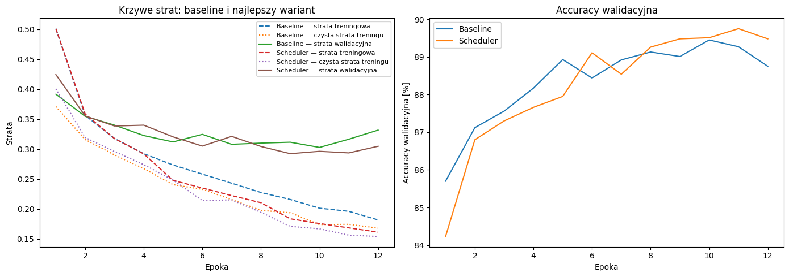

# Sprawozdanie laboratoryjne

**Przedmiot:** Uczenie głębokie do rozpoznawania obiektów  
**Zajęcia nr / temat:** 2 — Trenowanie i strojenie klasyfikatora obrazów  
**Autor / grupa:** Oskar Pietrzak / 3  
**Data:** 27.10.2026

## 1. Cel ćwiczenia

Wytrenowanie klasyfikatora obrazów ze zbioru FashionMNIST, zbadanie wpływu metod poprawy procesu uczenia (augmentacji, BatchNorm, dropout, weight decay i schedulera) na jakość klasyfikacji oraz analiza krzywych uczenia i luki generalizacji. Najlepszy wariant wybrano na podstawie najniższej straty walidacyjnej, a jego skuteczność porównano z modelem bazowym na niezależnym zbiorze testowym.

## 2. Metoda i implementacja

**Narzędzia:** Python, PyTorch, torchvision, matplotlib, numpy. Kod: notebook `lab2_trenowanie_klasyfikatora.ipynb`.

**Zbiór danych:** FashionMNIST — 60 000 obrazów treningowych i 10 000 testowych, skala szarości, rozmiar 28×28 pikseli i 10 klas ubrań oraz obuwia. Z oryginalnego zbioru treningowego wydzielono 50 000 przykładów do trenowania i 10 000 do walidacji. Oryginalne 10 000 obrazów testowych pozostawiono wyłącznie do końcowej oceny. Obrazy znormalizowano średnią 0,2860 i odchyleniem standardowym 0,3530.

**Model:** MLP z warstwą `Flatten`, dwiema warstwami ukrytymi `Linear(784, 256)` i `Linear(256, 128)` z aktywacją ReLU oraz warstwą wyjściową `Linear(128, 10)`. W zależności od wariantu dodawano BatchNorm i/lub dropout.

```python
class MLP(nn.Module):
    def __init__(self, use_bn=False, p_drop=0.0):
        super().__init__()
        layers = [nn.Flatten()]
        d = 28 * 28
        for h in (256, 128):
            layers.append(nn.Linear(d, h))
            if use_bn:
                layers.append(nn.BatchNorm1d(h))
            layers.append(nn.ReLU())
            if p_drop > 0:
                layers.append(nn.Dropout(p_drop))
            d = h
        layers.append(nn.Linear(d, 10))
        self.net = nn.Sequential(*layers)

    def forward(self, x):
        return self.net(x)
```

**Konfiguracja:** funkcja straty — CrossEntropyLoss; optymalizator — Adam; początkowy learning rate 1e-3; batch size 128; 12 epok; seed 0. Każdy wariant trenowano od nowa na tym samym podziale zbioru danych. W każdej epoce rejestrowano stratę treningową (`train_loss`), stratę na zbiorze treningowym w trybie ewaluacji (`train_eval_loss`), stratę walidacyjną (`val_loss`) i dokładność walidacyjną (`val_acc`). Najlepszy punkt kontrolny wybierano według **minimalnego `val_loss`**, nie maksymalnego accuracy.

**Testowane warianty:** Baseline (bez dodatkowych metod), Augmentacja (losowe odbicie poziome i `RandomCrop(28, padding=4)`), BatchNorm (`BatchNorm1d`), Dropout (`p = 0,3`), Weight decay (`1e-4`), Scheduler (`StepLR`, zmniejszenie learning rate o połowę co 4 epoki) oraz Połączony (wszystkie modyfikacje jednocześnie).

## 3. Wyniki

### 3.1 Porównanie konfiguracji

| Wariant | Najlepsza epoka | Accuracy walidacyjne | Strata walidacyjna | Luka generalizacji |
|---|---:|---:|---:|---:|
| Baseline | 10 | 89,45% | 0,3028 | 0,1287 |
| Augmentacja | 10 | 83,95% | 0,4390 | 0,0204 |
| BatchNorm | 7 | 88,86% | 0,3006 | 0,1157 |
| Dropout | 11 | 89,14% | 0,3019 | 0,0778 |
| Weight decay | 5 | 88,32% | 0,3200 | 0,0647 |
| **Scheduler** | **9** | **89,48%** | **0,2924** | **0,1212** |
| Połączony | 12 | 81,90% | 0,4745 | 0,0084 |

Najlepszym wariantem według założonego kryterium okazał się **Scheduler**, dla którego w 9. epoce uzyskano stratę walidacyjną **0,2924** i accuracy **89,48%**. W porównaniu z Baseline (strata 0,3028 i accuracy 89,45% w 10. epoce) strata spadła o 0,0104, a dokładność wzrosła o 0,03 punktu procentowego.

### 3.2 Krzywe uczenia najlepszego wariantu



*Rysunek 1. Krzywe strat treningowych, strat na czystym zbiorze treningowym, strat walidacyjnych i dokładności walidacyjnej dla Baseline oraz Scheduler w 12 epokach.*

Na wykresie strata treningowa maleje w obu wariantach. Jednocześnie strata walidacyjna po początkowym spadku oscyluje w okolicach 0,30–0,34, co wskazuje, że poprawa dopasowania do treningu nie zawsze przekłada się na poprawę na nowych danych. Baseline osiąga minimalne `val_loss = 0,3028` w 10. epoce, po czym jego strata walidacyjna wzrasta do 0,3317 w 12. epoce. Scheduler uzyskuje minimum `val_loss = 0,2924` w 9. epoce, a więc niżej niż Baseline. Accuracy walidacyjne obu wariantów wzrasta z około 84–86% na początku do około 89–90% pod koniec treningu.

### 3.3 Ocena na zbiorze testowym

| Wariant | Wybrana epoka | Accuracy testowe | Strata testowa |
|---|---:|---:|---:|
| Baseline | 10 | 89,19% | 0,3369 |
| Scheduler | 9 | 88,98% | 0,3202 |

Na zbiorze testowym Baseline uzyskał accuracy o **0,21 p.p.** wyższe niż Scheduler (89,19% wobec 88,98%), natomiast Scheduler osiągnął **niższą stratę o 0,0167** (0,3202 wobec 0,3369). Wyniki te nie są sprzeczne: CrossEntropyLoss uwzględnia także pewność predykcji, a accuracy tylko ich poprawność.

### 3.4 Luka generalizacji

Lukę generalizacji wyznaczono dla epoki wybranej na podstawie minimalnej straty walidacyjnej, zgodnie ze wzorem: `val_loss − train_eval_loss`. Obie straty obliczano w trybie ewaluacji na danych bez losowej augmentacji.

| Wariant | Epoka | Val loss | Train eval loss | Luka |
|---|---:|---:|---:|---:|
| Baseline | 10 | 0,3028 | 0,1741 | 0,1287 |
| Scheduler | 9 | 0,2924 | 0,1712 | 0,1212 |

Dla Baseline: `0,3028 − 0,1741 = 0,1287`. Dla Scheduler: `0,2924 − 0,1712 = 0,1212`. Luka zmniejszyła się o **0,0075**, co świadczy o niewielkim ograniczeniu różnicy między stratą treningową i walidacyjną. Pozostałe luki w tabeli 3.1 pochodzą z wyników eksperymentu; drobne rozbieżności z odejmowaniem wartości zaokrąglonych do czterech miejsc wynikają z precyzji obliczeń.

## 4. Analiza i interpretacja

- **Wpływ metod:** Scheduler uzyskał najmniejszą stratę walidacyjną (0,2924). BatchNorm (0,3006) i Dropout (0,3019) również nieznacznie poprawiły ten wynik względem Baseline (0,3028). Waga tych różnic jest ograniczona, ponieważ nie wykonano wielokrotnych powtórzeń eksperymentu.
- **Augmentacja i łączenie metod:** Augmentacja obniżyła accuracy walidacyjne do 83,95%, a wariant Połączony do 81,90%. Sugeruje to, że w zastosowanym ustawieniu dodatkowe utrudnienia treningu nie przyniosły korzyści. Sama liczba zastosowanych technik nie gwarantuje wyższej jakości modelu.
- **Przeuczenie:** Krzywe wskazują na rosnącą różnicę między stratą treningową a walidacyjną. W Baseline po 10. epoce strata treningowa nadal malała, podczas gdy strata walidacyjna rosła. Wybór najlepszego checkpointu według `val_loss` zapobiegł wykorzystaniu późniejszego, gorzej generalizującego stanu modelu.
- **Luka generalizacji:** Scheduler miał lukę 0,1212 wobec 0,1287 dla Baseline, jednak różnica jest mała. Najmniejsza luka nie oznacza automatycznie najlepszego klasyfikatora: wariant Połączony uzyskał lukę 0,0084, ale jednocześnie najniższą accuracy walidacyjną.
- **Walidacja a test:** Scheduler wygrał według straty walidacyjnej i miał niższą stratę testową, lecz Baseline osiągnął nieznacznie wyższą dokładność testową. Ocenianie modelu tylko jedną metryką mogłoby prowadzić do zbyt ogólnych wniosków.

## 5. Wnioski

Najlepszym wariantem według przyjętego kryterium **minimalnej straty walidacyjnej** był **Scheduler** (`val_loss = 0,2924`, accuracy walidacyjne 89,48% w 9. epoce), natomiast Baseline uzyskał `val_loss = 0,3028` i accuracy walidacyjne 89,45% w 10. epoce. Na zbiorze testowym Scheduler osiągnął mniejszą stratę (0,3202 wobec 0,3369), ale nieco niższą dokładność (88,98% wobec 89,19%). Luka generalizacji zmalała z 0,1287 do 0,1212. Augmentacja i wariant Połączony pogorszyły wyniki w zastosowanej konfiguracji. Krzywe uczenia pokazały, że należy zachowywać checkpoint z najlepszej epoki walidacyjnej, zamiast automatycznie wybierać ostatnią epokę. Dalsze eksperymenty mogłyby obejmować kilka powtórzeń treningu z różnymi seedami i osobne dostrojenie hiperparametrów każdej metody.
